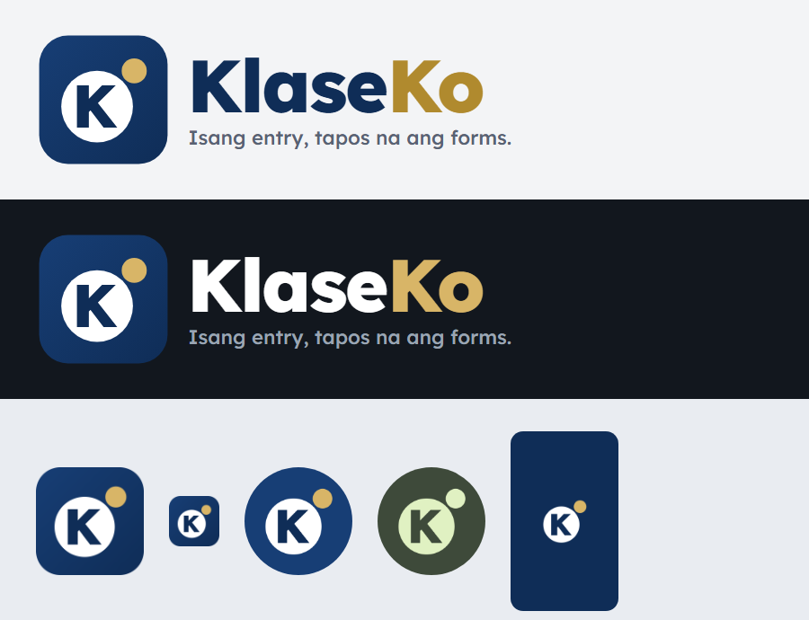

# KlaseKo brand guide

## Name

**KlaseKo** — from Filipino *"klase ko"*, "my class". One word, capital **K** twice: `KlaseKo`.
Never "Klaseko", "Klase Ko", "KLASEKO" or "Klase-Ko".

**Tagline:** *Isang entry, tapos na ang forms.* (One entry, and your forms are done.)

**One-line description:** Class records, exams and paper checking for DepEd teachers. Works offline.

## Logo

| File | Use |
| --- | --- |
| `assets/branding/klaseko-mark.svg` | The symbol alone: app icon, social profile, small spaces |
| `assets/branding/klaseko-logo.svg` | Symbol + name + tagline on light backgrounds: posters, letters, slides |
| `assets/branding/klaseko-logo-dark.svg` | The same on dark backgrounds |
| `assets/branding/app_icon.png` | 1024 px app icon |

The symbol is a navy **K** inside a white **answer bubble**, like the lettered bubbles on a test paper, with one gold **shaded bubble** beside it, on a navy rounded square. It says what KlaseKo does: answer sheets, read and checked. The K is the Lexend ExtraBold letter, the same as in the wordmark.

- Keep clear space around the logo of at least the height of the gold bubble.
- Do not recolor, stretch, rotate, outline or add shadows to the symbol.
- On navy backgrounds, use the symbol without its square (the lettered bubble and the gold bubble only), as on the About screen and the launch screen.
- On single-colour icons (Android themed icons), the K is cut out of the bubble.
- In the app the logo is drawn in code (`lib/ui/brand.dart`: `BrandMark`, `BrandWordmark`, `BrandLogo`), so it is sharp at every size.

## Colors

| Role | Light theme | Dark theme |
| --- | --- | --- |
| Navy (primary) | `#1B4A8C` | `#9DBBEA` |
| Navy deep (headers) | `#0F2D57` | `#1A2C47` |
| Gold (accent) | `#85600F` | `#D8B567` |
| Background | `#F3F4F6` | `#12171E` |
| Card | `#FFFFFF` | `#1A2029` |
| Text | `#1B2330` | `#E1E5EA` |
| Muted text | `#586273` | `#9BA5B3` |
| Success / warning / danger | `#2B7348` / `#9A5B00` / `#B0302A` | `#7CC69A` / `#E2B062` / `#EE8F86` |

Logo colors stay the same in both themes: navy `#173E75` → `#0F2D57`, gold `#D8B567`, white.
All text colors meet WCAG AA contrast. Status colors are always paired with a word or an icon.

## Typography

**Lexend** (SIL Open Font License), designed for easy reading. ExtraBold for the wordmark, Bold for
titles, Regular for body text. Printed DepEd forms use the standard PDF fonts.

## Voice

Warm, plain and practical, like a helpful co-teacher. English with familiar Filipino where it
feels natural ("Magandang umaga", "Tama o Mali", "Susi sa Pagwawasto").

- Use the words teachers already use: class record, MPS, SF2, Written Work, term.
- Say what happened and what to do next: "Part of the answers is outside the photo. Move the phone back a little."
- No blame, no jargon, no exclamation marks in errors.

## Names inside the app

| Area | Name | Notes |
| --- | --- | --- |
| Main tabs | **Today**, **Classes**, **Check**, **More** | Short, one word each |
| Home | **Today** | Greeting, quick actions, to-do list |
| Class page parts | **Attendance**, **Class record**, **Exams**, **Learners**, **Reports and school forms** | |
| Scanning | **Check papers** (action), **Scan** (button) | Results screen: **Check the result** |
| Items the scanner is unsure of | **Needs your check** | Never "error" |
| Importing | **Import questions** | Sources: photo, Word, PDF, pasted text |
| Grades | **Term grade**, **Final grade**, **Initial grade** | DO 015, s. 2026 wording |
| Exams in the class record | **Summative Test 1**, **Summative Test 2**, **Term Examination** | |
| Printed footer | **Prepared with KlaseKo** | Only on KlaseKo's own documents, never on official SF forms |
| Settings | **More → Appearance → Theme**: Follow my phone, Light, Dark | |

KlaseKo is an independent app and is not made by or affiliated with the Department of Education.
